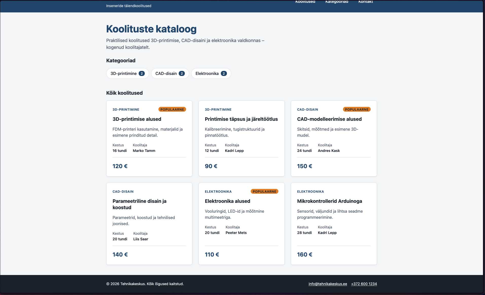

# Koolituste kataloog – Tehnikakeskus

Reacti rakendus, mis kuvab ettevõtte Tehnikakeskus koolituste kataloogi. Koolitused ja nende andmed on kirjutatud koodi sisse ning serverist andmeid ei laadita.



## Projekti käivitamine

```bash
npm install
npm run dev
```

Ava terminalis kuvatud aadress brauseris.

## Dokumentatsioon

- [Kolme struktuuri võrdlus (8.1)](docs/8.1-struktuuride-vordlus.md)
- [Komponentide hierarhia (8.2)](docs/8.2-komponentide-hierarhia.md)
- [Andmete edastamine Reactis](docs/andmete-edastamine.md) (töö on pooleli)
