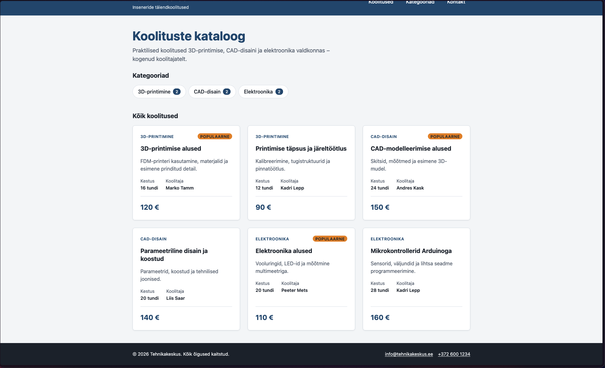

# Koolituste kataloog – Tehnikakeskus

Reacti rakendus, mis kuvab ettevõtte Tehnikakeskus koolituste kataloogi. Tegemist on staatilise kasutajaliidesega: koolitused ja nende andmed on kirjutatud koodi sisse ning serverist andmeid ei laadita.

## 1. Kolme struktuuri võrdlus (8.1)

Kõigi kolme lahenduse puhul on kasutajaliides sama: päis koos navigatsiooniga, lehe pealkiri ja sissejuhatus, koolituste kategooriad, koolituste nimekiri (iga koolitus eraldi kaardina) ja jalus kontaktandmetega.

### A. Üks suur komponent

```
App
```

Kogu kasutajaliides asub ühes komponendis. Päis, navigatsioonilingid, kategooriad, koolituste kaardid ja jalus on kõik kirjutatud otse `App` komponendi JSX-i sisse.

### B. Väga palju väikeseid komponente

```
App
├── Header
│   ├── CompanyName
│   ├── Tagline
│   └── Navigation
│       └── NavLink
├── Main
│   ├── PageHeading
│   │   ├── Title
│   │   └── Intro
│   ├── CategoryList
│   │   └── CategoryPill
│   └── CourseList
│       └── CourseCard
│           ├── CourseCategory
│           ├── CourseBadge
│           ├── CourseTitle
│           ├── CourseDescription
│           ├── CourseDetails
│           │   └── DetailItem
│           └── CoursePrice
└── Footer
    ├── Copyright
    └── ContactInfo
```

Iga väike element või elementide rühm on eraldi komponent, näiteks kaardi pealkiri ja hind.

### C. Vastutuse järgi jaotatud komponendid (valitud lahendus)

```
App
├── Header
│   └── Navigation
├── main
│   ├── PageHeading
│   ├── CategoryList
│   └── CourseList
│       └── CourseCard
└── Footer
```

Kasutajaliidese terviklikud osad on eraldi komponendid. Märkus: `main` on `App` komponendis tavaline semantiline HTML-element, mitte eraldi komponent.

### Võrdlus

**Millist lahendust on kõige lihtsam mõista?**

- A on alguses lihtne, sest kõik on ühes failis, kuid fail muutub kiiresti pikaks ja segaseks.
- B on kõige raskemini jälgitav, sest ühe kaardi koodi leidmiseks tuleb avada palju väikeseid faile.
- C on kõige arusaadavam, sest komponentide nimed vastavad sellele, mida lehel näha on.

**Kui lihtne on muuta ainult koolituste kuvamise osa?**

- A-s tuleb koolituste osa leida suurest failist ning muutmisel on oht puudutada ka teisi osi.
- B-s tuleb muuta mitut väikest komponenti eri failides, näiteks pealkirja, hinda ja kirjeldust.
- C-s piisab ühest komponendist `CourseCard` ja selle CSS-failist. Paigutuse muutmiseks tuleb muuta `CourseList` komponenti.

**Millises lahenduses tekib kõige tõenäolisemalt korduv kood?**

- A-s: iga koolituse kaart, navigatsiooniliinkide ja kategooriate kood kirjutatakse korduvalt välja.
- B-s on korduvat sisu vähe, kuid iga väikese komponendi juures korduvad importimine, propside edastamine ja faili ülesehitus.
- C-s on kordusi vähe, sest üks `CourseCard` kuvatakse kõigi koolituste jaoks.

**Milliseid komponente saaks kasutada ka rakenduse teistes osades?**

- A-s mitte ühtegi.
- B-s on palju väikeseid osi, kuid enamik neist (näiteks `Title` või `Intro`) on liiga lihtsad, et taaskasutus oleks kasulik.
- C-s `CourseCard` ja `CourseList` (näiteks populaarsete koolituste jaotises), `Navigation`, `Header` ja `Footer`.

**Mis probleemid võivad tekkida liiga paljude väikeste komponentide kasutamisel?**

- Propsid tuleb edastada läbi mitme taseme.
- Ühe kaardi nägemiseks tuleb avada palju faile.
- Nimede välja mõtlemine ja failide haldamine võtab palju aega.
- Uuel lugejal on raske leida, kus mingi osa asub.
- Komponendid lisavad vahekihte, kuid taaskasutust ei tule juurde.

**Millise lahenduse valiksin edasiseks arendamiseks ja miks?**

Valin lahenduse C. Iga komponent vastab ühele nähtavale osale lehel ja sellel on üks selge ülesanne. `CourseCard` on ainus tõeliselt korduv osa ning seda saab kasutada mitmes kohas. Koolituste kuvamist saab muuta ühes kohas, ilma et peaks teisi osi puutuma.

## 2. Komponentide hierarhia (8.2)

```
App
├── Header
│   └── Navigation
├── main
│   ├── PageHeading
│   ├── CategoryList
│   └── CourseList
│       └── CourseCard
└── Footer
```

| Komponent | Ülesanne | Sisaldab | Propsid |
|---|---|---|---|
| `App` | Koondab lehe ja impordib andmed | kõiki allpool olevaid | puuduvad |
| `Header` | Kuvab ettevõtte nime ja kirjelduse, sisaldab navigatsiooni | `Navigation` | `companyName`, `tagline` |
| `Navigation` | Lehesisesed lingid | ei sisalda | `ariaLabel` |
| `PageHeading` | Lehe pealkiri ja lühike sissejuhatus | ei sisalda | `title`, `intro` |
| `CategoryList` | Koolituste kategooriad | ei sisalda | `categories`, `courses` |
| `CourseList` | Jaotise pealkiri ja koolituste kaardid | `CourseCard` | `courses` |
| `CourseCard` | Ühe koolituse info | ei sisalda | `title`, `description`, `duration`, `price`, `category`, `instructor`, `popular` |
| `Footer` | Autoriõigus ja kontaktandmed | ei sisalda | `companyName`, `email`, `phone` |

Andmete liikumine: `data/courses.js` → `App` → `CourseList` → `CourseCard`.

### Põhjendus

- Iga komponent vastab ühele nähtavale osale lehel ja tal on üks ülesanne.
- `CourseCard` kuvatakse kuus korda, seetõttu on see korduvkasutatav komponent.
- `CourseList` ja `CourseCard` on eraldi, sest nimekirja paigutus ja läbikäimine on teine ülesanne kui ühe koolituse kuvamine.
- Andmed asuvad kasutajaliidesest eraldi failis, et sisu muutmisel ei peaks komponente puutuma.
- Pealkirja ja hinda ei ole eraldi komponentideks tehtud, sest neid ei kasutata kuskil mujal kui kaardil.
- CSS: üldised muutujad ja põhikujundus on failis `index.css`, kõik muu on komponendi enda CSS-failis.

## 3. Projekti käivitamine

```bash
npm install
npm run dev
```

Ava terminalis kuvatud aadress brauseris.

## 4. Komponentide vastutus

- **App** – koondab kogu lehe ning annab andmed edasi alamkomponentidele.
- **Header** – kuvab ettevõtte nime ja kirjelduse ning sisaldab navigatsiooni.
- **Navigation** – kuvab lehesisesed lingid (koolitused, kategooriad, kontakt).
- **PageHeading** – kuvab lehe pealkirja ja sissejuhatuse.
- **CategoryList** – kuvab koolituste kategooriad.
- **CourseList** – kuvab koolituste nimekirja ja loob iga koolituse jaoks ühe `CourseCard` komponendi.
- **CourseCard** – kuvab ühe koolituse andmed.
- **Footer** – kuvab autoriõiguse ja kontaktandmed.

## 5. Propsid

Koolituste andmed asuvad failis `src/data/courses.js`. `App` impordib need ja annab koolituste massiivi propsina edasi komponendile `CourseList`. `CourseList` käib massiivi läbi meetodiga `map` ja loob iga koolituse jaoks ühe `CourseCard` komponendi, andes sellele propsidena edasi koolituse nime, kirjelduse, kestuse, hinna, kategooria, koolitaja ja populaarsuse.

`CourseCard` võtab propsid vastu funktsiooni parameetris `{ title, description, duration, price, category, instructor, popular }` ja kasutab neid oma JSX-is. Seetõttu on kõik kaardid sama kujundusega, kuid sisu on igaühel erinev.

Kahe koodinäite erinevus (`CourseCard(props)` ja `CourseCard({ title, ... })`): kasutajaliideses tulemus ei erine. Erinevus on ainult süntaksis. Esimeses kasutatakse väärtusi kujul `props.title`, teises on need juba parameetrites eraldatud ja neid kasutatakse kujul `title`.

## 6. Populaarsete koolituste jaotis (8.4)

Täidan pärast 8.4 tegemist.

## 7. Ekraanipildid

### Arvutivaade


