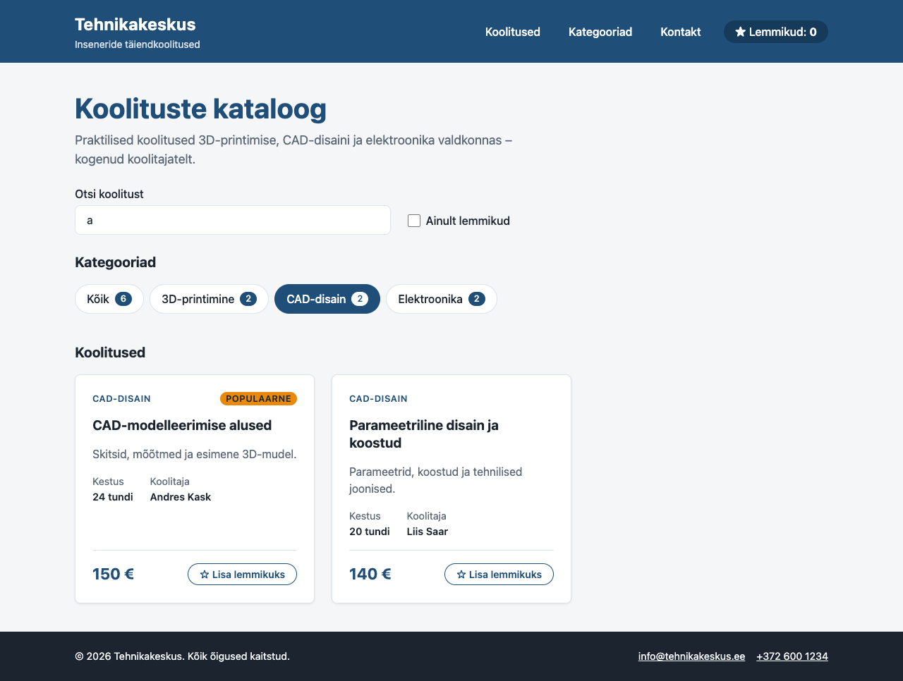
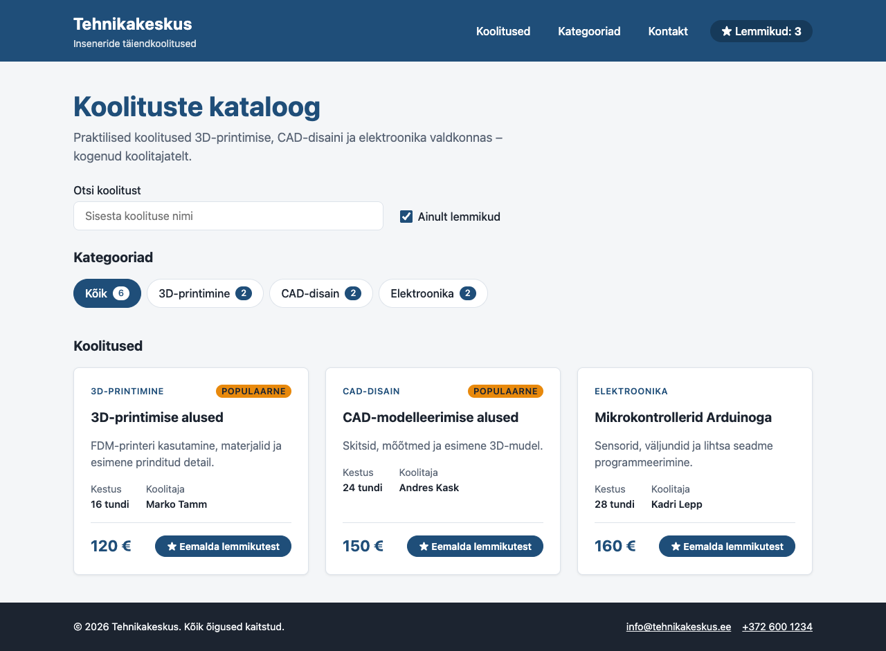

# Andmete edastamine Reactis

[← Tagasi avalehele](../README.md)

## 1. Olemasoleva lahenduse analüüs

Enne ülesannet olid rakenduse olulised osad järgmised:

- Kursuste andmed asuvad failis `src/data/courses.js`, `App` impordib need.
- Kursuste nimekirja kuvab `CourseList`.
- Ühte kursust kuvab `CourseCard`.
- Rakenduse päis on `Header`.

```
App                     impordib categories ja courses
├── Header              props: companyName, tagline
│   └── Navigation      props: ariaLabel
├── main
│   ├── PageHeading     props: title, intro
│   ├── CategoryList    props: categories, courses
│   └── CourseList      props: courses
│       └── CourseCard  props: title, description, duration, price,
│                              category, instructor, popular
└── Footer              props: companyName, email, phone
```

Kõik andmed liikusid props'idena ülevalt alla ja rakenduses ei olnud olekut. `CourseCard` sai juurde uue propsi `id`, sest lemmiku märkimiseks peab kaart teadma oma kursuse identifikaatorit.

## 2. Komponentide skeem

Tärniga `[C]` märgitud komponendid kasutavad lemmikute konteksti.

```
App
└── FavoritesProvider        hoiab lemmikute olekut ja jagab konteksti
    ├── Header [C]           loeb favorites, kuvab lemmikute arvu
    │   └── Navigation
    ├── main
    │   ├── PageHeading
    │   └── Catalog [C]      olek: search, selectedCategory, showOnlyFavorites
    │       │                loeb favorites, filtreerib nimekirja
    │       ├── CourseFilters    otsinguväli ja "Ainult lemmikud"
    │       ├── CategoryList     kategooria valik
    │       └── CourseList       saab filtreeritud kursused
    │           └── CourseCard [C]   loeb favorites, kasutab toggleFavorite
    └── Footer
```

## 3. Propsid ja olek

**Props'idega edastatavad andmed:**

| Komponent | Propsid |
|---|---|
| `Catalog` | `categories`, `courses` |
| `CourseFilters` | `search`, `onSearchChange`, `showOnlyFavorites`, `onShowOnlyFavoritesChange` |
| `CategoryList` | `categories`, `courses`, `selectedCategory`, `onSelectCategory` |
| `CourseList` | `courses`, `emptyMessage` |
| `CourseCard` | `id`, `title`, `description`, `duration`, `price`, `category`, `instructor`, `popular` |

**Olekuna hallatavad andmed:**

| Olek | Asukoht | Tähendus |
|---|---|---|
| `search` | `Catalog` | otsinguvälja tekst |
| `selectedCategory` | `Catalog` | valitud kategooria |
| `showOnlyFavorites` | `Catalog` | kas kuvatakse ainult lemmikuid |
| `favorites` | `FavoritesProvider` | lemmikkursuste ID-d |

Kuvatavat nimekirja `visibleCourses` ei hoita olekus. See arvutatakse igal renderdamisel olemasolevast olekust, seega ei saa nimekiri filtritega vastuollu minna.

## 4. Miks lemmikud on Contextis

Lemmikuid vajavad `Header`, `Catalog` ja `CourseCard`, mis asuvad komponendipuu eri harudes. Props'idega tuleks olek tõsta `App` komponenti ning anda see läbi `Catalog` ja `CourseList` komponentide. `CourseList` ei kasuta lemmikuid ise, ta annaks need ainult edasi. Seda nimetatakse props drilling'uks.

Context teeb `favorites` ja `toggleFavorite` kättesaadavaks kõigile `FavoritesProvider` sees olevatele komponentidele. Kui `CourseCard` muudab lemmikuid, renderdatakse konteksti kasutavad komponendid uuesti ja päises olev arv uueneb kohe.

Context ei asenda `useState`-i. Olek luuakse endiselt `useState`-iga `FavoritesProvider` komponendis, Context ainult jagab seda.

**Failid:**

- `src/context/FavoritesContext.js` loob konteksti `createContext`-iga.
- `src/context/FavoritesProvider.jsx` hoiab olekut ja annab väärtuse edasi.
- Kontekst ja Provider on eraldi failides, sest projekti ESLinti Fast Refresh'i reegel lubab komponendi failist eksportida ainult komponente.

**Salvestamine:** lemmikud salvestatakse brauseri `localStorage`-isse, et need säiliksid lehe uuesti laadimisel. See ei olnud ülesande nõue. `useState(readStoredFavorites)` loeb väärtuse ainult esimesel renderdamisel ja `useEffect` salvestab selle iga kord, kui `favorites` muutub. Vigased andmed ning olematute kursuste ID-d jäetakse lugemisel välja, et päises kuvatav arv oleks õige.

## 5. Testimine

Testid tehti päris rakenduses Chrome'i brauseris.

| Kasutusjuht | Tulemus |
|---|---|
| Otsin nimekirjas olevat kursust (`arduino`) | leitakse 1 kursus |
| Otsin kursust, mida ei ole (`olematu`) | kuvatakse teade |
| Valin kategooria ja kasutan otsingut | mõlemad tingimused kehtivad |
| Muudan kategooriat | otsingutekst jääb alles |
| Muudan otsingut | valitud kategooria jääb alles |
| Märgin mitu kursust lemmikuks | päise arv suureneb kohe |
| Eemaldan ühe lemmiku | päise arv väheneb kohe |
| Avan ainult lemmikute vaate | kuvatakse ainult lemmikud |
| Võrdlen päise arvu nimekirjaga | arvud klapivad |
| Laadin lehe uuesti | lemmikud jäävad alles |
| Rikun `localStorage` andmed | rakendus töötab, vigased väärtused jäetakse välja |
| Kitsas ekraan (375 px) | horisontaalset kerimist ei teki |

## 6. Ekraanipildid

### Otsing ja kategooriafilter



### Lemmikute vaade ja lemmikute arv päises



## 7. Kaitsmise märkmed

**Kus luuakse ja muudetakse otsingu ning kategooria olekut?**
Need luuakse `Catalog.jsx` failis `useState`-iga. Muutmise funktsioonid `setSearch` ja `setSelectedCategory` antakse propsidena komponentidele `CourseFilters` ja `CategoryList`, kus neid kutsutakse sündmuste käsitlejates.

**Miks Reacti olekut ei muudeta otse?**
Otsene muutmine ei anna Reactile teada, et komponenti tuleb uuesti renderdada. Massiivi puhul võrdleb React viidet, seega `push` jätaks viite samaks. Seetõttu luuakse `[...current, id]` või `filter` abil uus massiiv.

**Kus luuakse Context ja Provider?**
Context luuakse failis `FavoritesContext.js`, Provider asub failis `FavoritesProvider.jsx`. `App` ümbritseb sellega päise, sisu ja jaluse.

**Kuidas komponent saab konteksti väärtuse kätte?**
`const { favorites, toggleFavorite } = useContext(FavoritesContext);`. React leiab komponendipuus lähima Provider'i ja tagastab selle `value`.

**Miks lemmikuid ei edastata enam props'idena?**
Vahepealsed komponendid, näiteks `CourseList`, ei vaja neid andmeid. Context ühendab andmed otse komponentidega, kes neid kasutavad.

**Väikese muudatuse näited:**

- Uus filter: lisa `Catalog` komponenti uus olek ja uus tingimus `visibleCourses` arvutusse, näiteks `const matchesPopular = !onlyPopular || course.popular;`.
- Lemmikute loend päises: impordi `courses`, leia `courses.filter((course) => favorites.includes(course.id))` ja kuva pealkirjad `map`-iga.
